# 🤖 LittleHelper for Godot 4

<p align="center">
  
  <br>
  <strong>In-Engine AI Copilot & Model Context Protocol (MCP) Bridge for Godot 4</strong>
</p>

**LittleHelper** is a lightweight, zero-dependency Godot 4 editor plugin that bridges the gap between your game engine and modern AI models. It works in two flexible modes:

1. **In-Engine AI Chat:** Pair-program directly inside the Godot editor using your favorite LLM (OpenAI, Anthropic Claude, Google Gemini, DeepSeek, local Ollama, or custom OpenAI-compatible endpoints).
2. **External Agent (MCP Bridge):** Connect autonomous AI coding agents (Antigravity, Cursor, Claude Desktop) directly to your running Godot editor via the open [Model Context Protocol (MCP)](https://modelcontextprotocol.io/).

---

## ✨ Features

- **🎮 20 Native Engine Tools:** Live scene inspection, node creation/removal, scene instantiation, reparenting, property editing, script attachment, signal wiring, project settings, GDScript evaluation, scene management, project execution, and debug log tailing.
- **↩️ Full Undo / Redo:** Scene modifications (`add_node`, `remove_node`, `instantiate_scene`, `reparent_node`, `set_node_property`, `attach_script`, `connect_signal`) integrate with Godot's `EditorUndoRedoManager` (`Ctrl+Z` / `Ctrl+Y`).
- **⚡ Slash Commands:** Quick editor shortcuts with autocompletion (`/selected`, `/select`, `/tree`, `/inspect`, `/tools`, `/save`, `/open`, `/remove`, `/run`, `/stop`, `/logs`, `/setting`, `/eval`, `/clear`).
- **🔒 Secure Credentials:** API keys are stored exclusively in `user://little_helper_settings.cfg`—never in `res://` or source control.
- **📦 Zero External Dependencies:** In-engine chat uses Godot's native `HTTPRequest`. The MCP bridge uses standard Node.js built-ins (`net`, `readline`). No `npm install` or third-party packages required.

---

## 📋 Compatibility & Requirements

- **Engine:** Godot 4.2+ (Tested on Godot 4.3 & 4.4).
- **In-Engine Chat:** **Zero external dependencies.** Uses Godot's built-in `HTTPRequest`.
- **MCP Bridge (Optional):** Requires [Node.js](https://nodejs.org/) (v18+ recommended) installed on your system only if you want to connect external agents (Cursor, Claude Desktop, Antigravity) via stdio MCP.

---

## 🚀 Quick Start

### 1. Installation
1. Copy or clone the `addons/little_helper` folder into your Godot project's `addons/` directory.
2. In the Godot editor, open **Project → Project Settings → Plugins**.
3. Enable the **LittleHelper** plugin.
4. The LittleHelper dock will appear in your editor docks (usually beside the Inspector or FileSystem).

---

## 🛠️ Operating Modes

Open the **Settings drawer** (gear icon in the top header) to choose your operating mode:

### Mode 1: In-Engine Chat
Chat directly with an AI assistant inside the dock.
- **Supported Providers:**
  - **OpenAI:** `gpt-4o`, `gpt-4o-mini`, etc.
  - **Anthropic Claude:** `claude-3-5-sonnet-20241022`, etc.
  - **Google Gemini:** `gemini-1.5-flash`, `gemini-1.5-pro`, etc.
  - **DeepSeek:** `deepseek-chat`, `deepseek-coder`
  - **Ollama (Local Offline):** `llama3`, `mistral`, `qwen2.5-coder`, etc.
  - **Custom Endpoint:** Any OpenAI-compatible server (LM Studio, LocalAI, vLLM, OpenRouter).

### Mode 2: External Agent (MCP Bridge)
Turn your Godot editor into an MCP server. External AI coding assistants can inspect and modify your project live while you work.

Add the following to your agent's MCP configuration (`mcp_config.json` or `claude_desktop_config.json`):

```json
{
  "mcpServers": {
    "godot-little-helper": {
      "command": "node",
      "args": [
        "addons/little_helper/bridge/mcp_bridge.js"
      ],
      "env": {
        "GODOT_PORT": "9099"
      }
    }
  }
}
```
*(Tip: You can click the **"Copy MCP Config"** button inside the LittleHelper settings drawer to copy your project's exact absolute path snippet).*

### Mode 3: Dual Mode
Both In-Engine Chat and the External MCP Bridge run concurrently.

---

## ⌨️ Slash Commands

Type `/` in the prompt input to open the command autocomplete menu:

| Command | Usage | Description |
| :--- | :--- | :--- |
| `/help` | `/help` | Show all commands and dock status |
| `/selected` | `/selected` | Inspect currently selected node(s) |
| `/select` | `/select <node_path>` | Select and focus a node in the scene tree & inspector |
| `/tree` | `/tree` | View full scene hierarchy |
| `/inspect` | `/inspect <node_path>` | Inspect node properties, transform, and script |
| `/tools` | `/tools` | List all 20 registered engine & MCP tools |
| `/save` | `/save [all]` | Save the active scene (or `/save all` for all open scenes) |
| `/open` | `/open <scene_path>` | Open a scene (`.tscn`) in the editor tab |
| `/remove` | `/remove <node_path>` | Remove a node from scene with Undo/Redo |
| `/run` | `/run [scene_path]` | Run main project scene (or custom scene path) in debug mode |
| `/stop` | `/stop` | Stop the running debug instance |
| `/logs` | `/logs [lines]` | Tail recent engine output and error logs (`godot.log`) |
| `/setting` | `/setting <name_or_prefix> [value]` | Get, set, or search ProjectSettings (`project.godot`) |
| `/eval` | `/eval <code>` | Evaluate a GDScript expression or code block |
| `/clear` | `/clear` | Clear conversation history |

---

## 🧰 Registered MCP Tools

When connected via MCP, external agents have access to 20 real-time tools:

### Scene & Node Hierarchy
1. `get_selected_nodes`: Get currently selected editor nodes.
2. `get_scene_tree`: Traverse full node hierarchy with configurable `max_depth`.
3. `inspect_node`: Detailed node metadata, export properties, scripts, and configuration warnings.
4. `select_node`: Programmatically select and focus a node in Godot's inspector.
5. `add_node`: Instantiate and attach new child nodes with Undo/Redo.
6. `remove_node`: Delete nodes from the active scene with Undo/Redo.
7. `instantiate_scene`: Spawn packed sub-scene instances (`.tscn`) into the hierarchy with Undo/Redo.
8. `reparent_node`: Move nodes to a new parent in the active scene with Undo/Redo.
9. `set_node_property`: Mutate properties (types, vectors, colors) with Undo/Redo.
10. `connect_signal`: Wire signals between nodes with Undo/Redo.
11. `attach_script`: Assign a GDScript file to a node with Undo/Redo.

### Scene & Project Lifecycle
12. `save_scene`: Save active scene or all modified scenes to disk.
13. `open_scene`: Open and switch active editor scene from path.
14. `run_project`: Launch debug instance of main scene or specified `.tscn`.
15. `stop_project`: Kill the running debug instance.
16. `get_debug_logs`: Tail the Godot engine log file (`user://logs/godot.log`).
17. `project_setting`: Get, set, or search project settings in `project.godot`.

### Reflection & Code Execution
18. `get_class_info`: Query Godot's built-in `ClassDB` for methods, properties, and signals.
19. `read_script`: Read source code of any GDScript with optional line ranges.
20. `execute_code`: Execute a dynamic GDScript snippet or expression inside the editor with scene root access.

---

## 📁 Directory Structure

```text
addons/little_helper/
├── plugin.cfg                  # Plugin metadata & editor registration
├── little_helper.gd            # Plugin lifecycle entry script
├── icon.svg                    # Mascot avatar & editor icon
├── LICENSE.txt                 # MIT License
├── README.md                   # Plugin documentation
├── bridge/
│   └── mcp_bridge.js           # Lightweight Node.js stdio MCP bridge
├── src/
│   ├── core/
│   │   ├── tool_registry.gd    # Central tool dispatcher & aggregator
│   │   └── bridge_server.gd    # Localhost TCP JSON-RPC bridge server
│   ├── tools/
│   │   ├── tool_utils.gd       # Shared engine utilities & variant sanitizing
│   │   ├── scene_tools.gd      # Scene hierarchy inspection & selection
│   │   ├── node_tools.gd       # Node creation, reparenting & Undo/Redo mutations
│   │   ├── project_tools.gd    # Scene lifecycle, debug logs & ProjectSettings
│   │   └── code_tools.gd       # ClassDB reflection & dynamic GDScript evaluation
│   ├── agent/
│   │   └── llm_client.gd       # Native HTTPRequest multi-provider LLM client
│   └── ui/
│       ├── little_helper_dock.gd   # Dock controller & slash command handling
│       └── little_helper_dock.tscn # Dock user interface & settings panel
└── icons/                      # Custom vector UI icons
```

---

## 📄 License

MIT License. Free to use, modify, and distribute in any personal or commercial Godot project.

